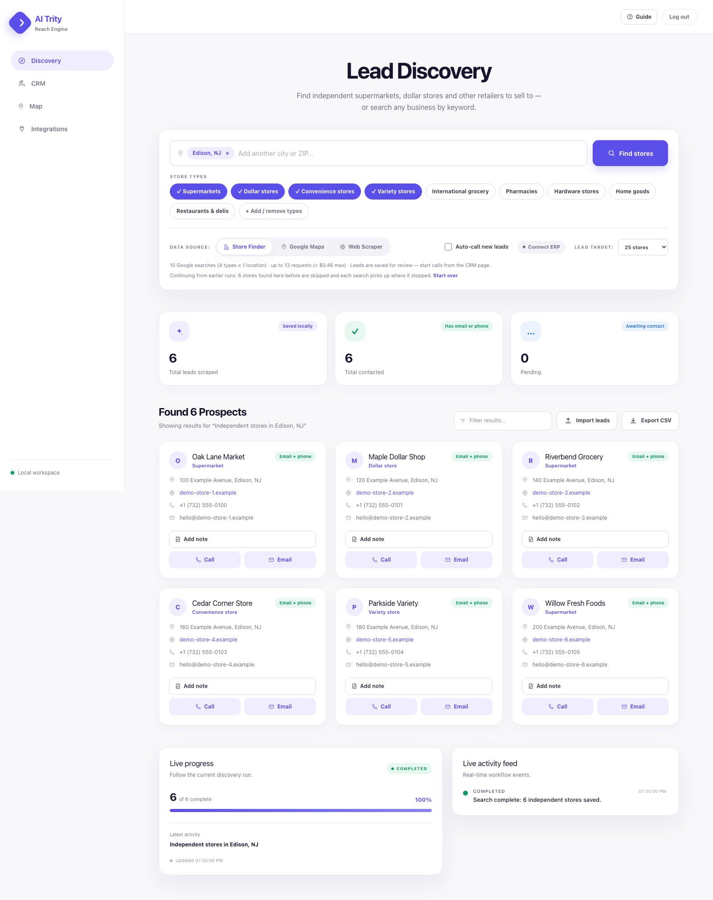
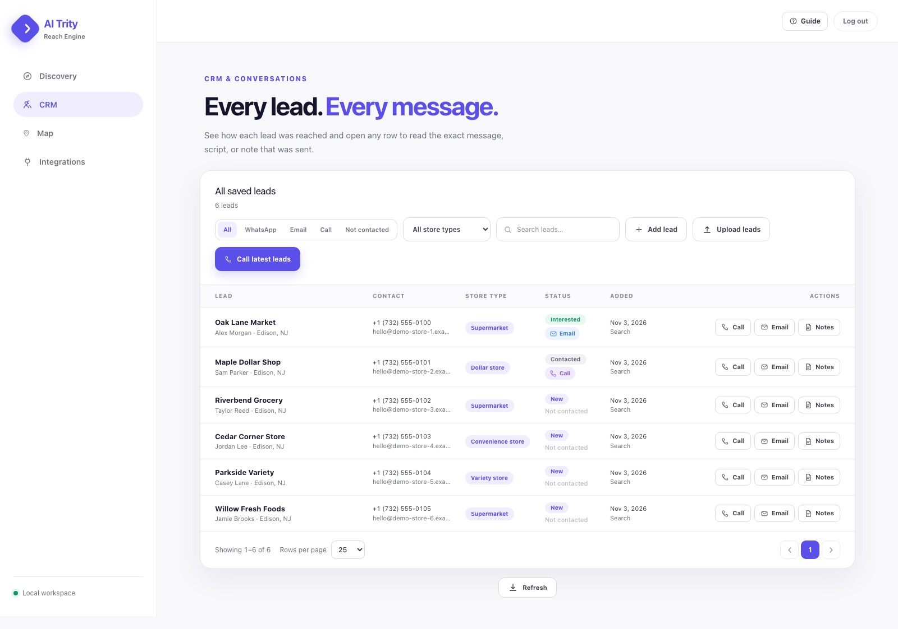
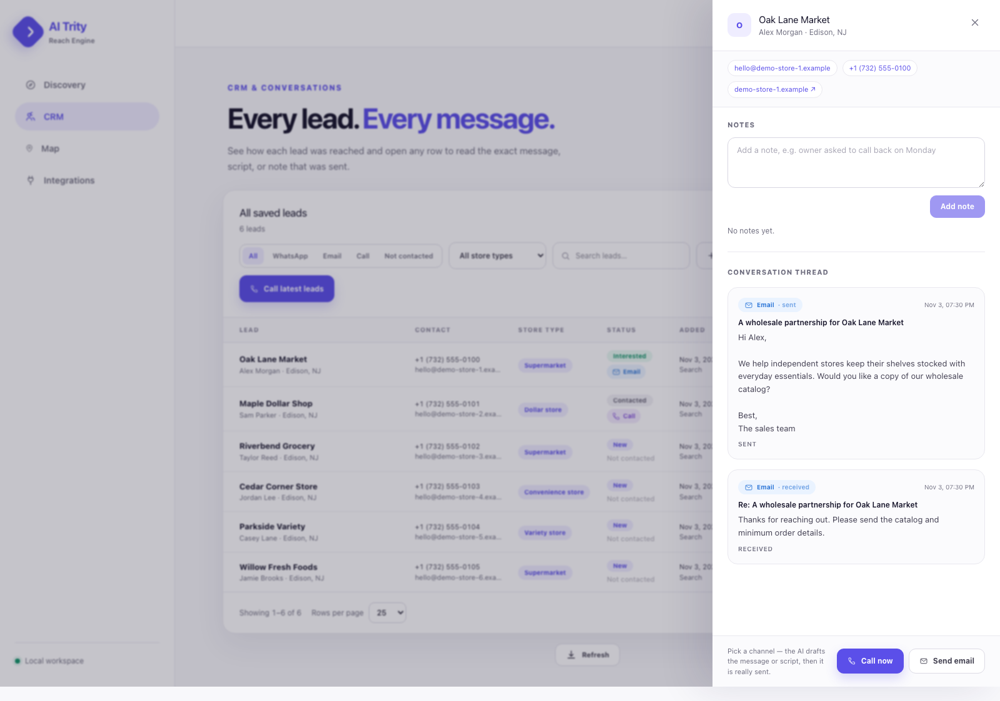
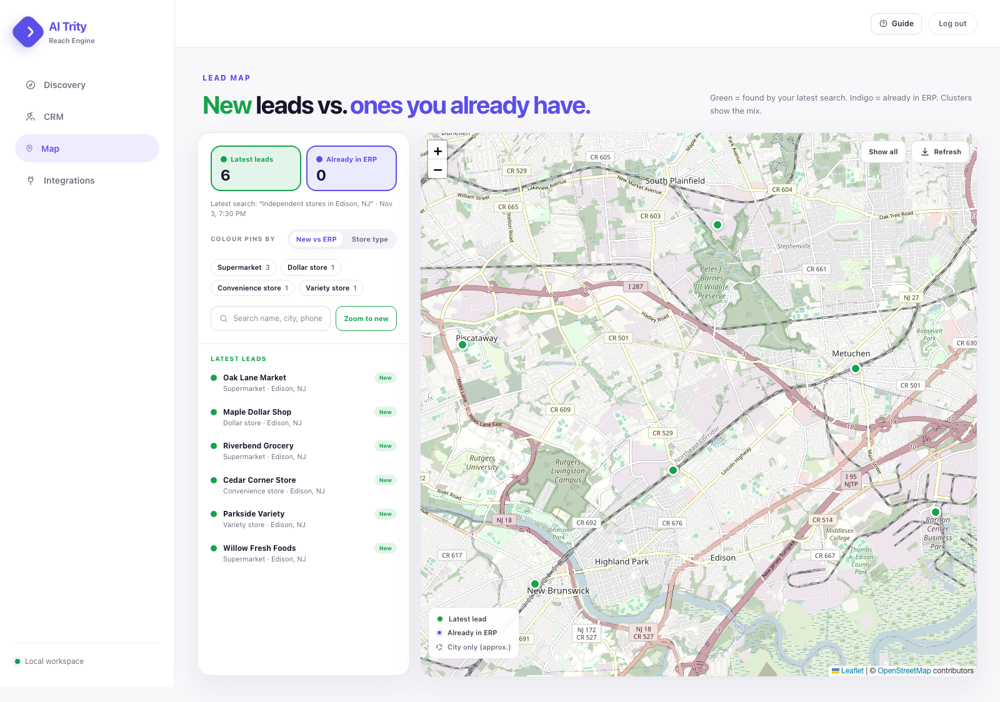
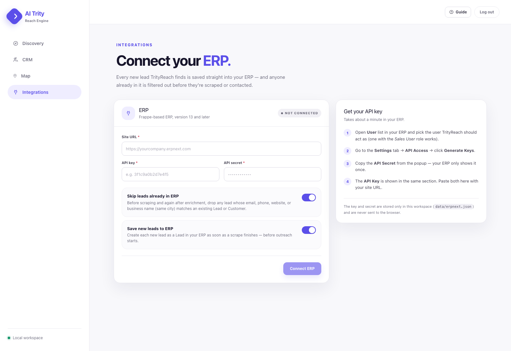

# TrityReach

Find business leads, collect published contact details, manage conversations, and connect your sales pipeline to ERPNext. TrityReach combines a Next.js dashboard with a Python scraper and optional n8n outreach workflows.



[Screenshots](#screenshots) · [Quick start](#quick-start) · [Configuration](#configuration) · [Command-line scraper](#command-line-scraper) · [Integrations](#integrations) · [Development](#development)

## Features

- **Three discovery sources:** Store Finder for retail prospects, Google Maps for any business type, and free web search.
- **Contact extraction:** business name, contact person, email, phone, website, city, address, store type, and map coordinates when available.
- **Live execution:** progress tracking, activity events, searchable prospect cards, and CSV export.
- **Persistent CRM:** saved leads across runs, pagination, search, channel and store-type filters, and lead notes.
- **Lead imports:** manual entry and CSV/Excel uploads with column mapping and duplicate checks.
- **Conversation history:** email, WhatsApp, and call records received from your outreach workflow.
- **Lead map:** clustered markers, latest-run and ERP filters, and cached address geocoding.
- **ERPNext integration:** save new leads, skip existing contacts, import ERP leads, and sync the CRM back to ERPNext.
- **Dashboard login:** password-protected pages and APIs, plus an interactive guided tour.

## Screenshots

These are captures of the running application with fictional sample leads and conversations. The ERP connection is shown disconnected.

### CRM

Search saved leads, filter by contact channel or store type, import lists, and start outreach.



### Conversations

Open a lead to view its contact details, notes, and conversation thread.



### Lead map

Explore lead locations on an OpenStreetMap map with clustered markers and filters.



### Integrations

Connect ERPNext and control automatic lead saving and duplicate filtering.



## Tech stack

| Layer | Technologies |
| --- | --- |
| Dashboard | Next.js 16, React 19, TypeScript, Tailwind CSS 4 |
| Scraping | Python, Crawl4AI, Playwright Chromium, Beautiful Soup, DDGS |
| Storage | SQLite, CSV, local JSON files |
| Maps | Leaflet, marker clustering, OpenStreetMap, Nominatim |
| Optional services | Google Places, OpenAI, n8n, ERPNext |

## Quick start

### Prerequisites

- Node.js **22.13 or later**, with the built-in `node:sqlite` module available.
- npm.
- Python **3.12** and support for virtual environments.
- Chromium installed through Playwright/Crawl4AI as shown below.

Run these commands from the project root on macOS or Linux.

### 1. Install dependencies

```bash
npm ci
python3.12 -m venv venv
venv/bin/python -m pip install -r requirements.txt
venv/bin/playwright install chromium
venv/bin/crawl4ai-setup
```

### 2. Configure the environment

For a fresh checkout, create the local configuration file:

```bash
cp .env.example .env
```

If `.env` already exists, edit it directly. Set the dashboard credentials before starting:

```dotenv
AUTH_USERNAME=admin
AUTH_PASSWORD=replace-with-your-own-password
```

Leave `N8N_WEBHOOK_URL` empty until you have a working outreach workflow; the example file contains a placeholder URL. Other service keys are optional and enable the features described below.

### 3. Start the dashboard

```bash
npm run dev
```

Open [http://localhost:3000](http://localhost:3000) and sign in with the credentials from `.env`. The dashboard launches `venv/bin/python` for scraper jobs.

### 4. Find your first leads

1. Open **Discovery** and choose a source. **Web Scraper** works without a Google API key.
2. Enter a business keyword and location, or choose store types and cities for **Store Finder**.
3. Set the lead target and start discovery.
4. Review the prospect cards and live activity, then export the results or open **CRM**.

**Auto-call new leads** is off by default. Enabling it sends new leads to the configured outreach webhook after a run.

On Windows, create the virtual environment with `py -3.12 -m venv venv`, then replace `venv/bin/python`, `venv/bin/playwright`, and `venv/bin/crawl4ai-setup` with the corresponding executables under `venv\Scripts\`. Dashboard scraper jobs automatically use `venv\Scripts\python.exe` on Windows.

## Configuration

Use [.env.example](.env.example) as the configuration reference. Restart the server after changing credentials or environment settings.

| Variable | Purpose |
| --- | --- |
| `AUTH_USERNAME`, `AUTH_PASSWORD` | Required dashboard login credentials. Changing the password invalidates existing sessions. |
| `GOOGLE_MAPS_API_KEY` | Required for Google Maps and Store Finder. Enable the Google Places API and billing. |
| `OPENAI_API_KEY` | Optional match confirmation and enrichment using contact details found on the page. |
| `OPENAI_MODEL` | Optional model override; the scraper defaults to `gpt-4o-mini`. |
| `N8N_WEBHOOK_URL` | Optional workflow endpoint for automated and manually triggered outreach. |
| `INBOUND_WEBHOOK_SECRET` | Bearer secret for inbound activity and conversation POST requests. |
| `ERPNEXT_URL`, `ERPNEXT_API_KEY`, `ERPNEXT_API_SECRET` | Optional ERPNext credentials for standalone CLI runs. Configure dashboard jobs on **Integrations**. |
| `ERPNEXT_SAVE_LEADS` | CLI setting: `1` to create new ERPNext leads, `0` to disable. |
| `ERPNEXT_SKIP_EXISTING` | CLI setting: `1` to skip existing ERP contacts, `0` to disable. |

The dashboard stores its ERP connection in `data/erpnext.json` and passes those settings to scraper jobs. Dashboard jobs use that connection rather than the CLI's `ERPNEXT_*` values.

## Discovery sources

| Source | CLI value | API key | Behavior |
| --- | --- | --- | --- |
| Store Finder | `stores` | Google Maps | Searches selected retail categories across cities or US ZIP codes; can exclude chains and remember previous searches. |
| Google Maps | `maps` | Google Maps | Finds business listings with phone/address details, including businesses without websites. |
| Web Scraper | `web` | None | Searches the web through DDGS and follows business links from directories. Results vary with search-engine availability and throttling. |

Store Finder supports custom categories through **+ Add / remove types**. Built-in categories live in `store-types.json`; customizations live in `data/store-types.json`. ZIP searches use cached Nominatim lookups; a radius of `0` keeps results inside the selected ZIP. Previous search coverage is stored in `data/store-search.db`, so repeat runs can continue discovering new stores.

Google discovery uses billable API requests. The dashboard shows a request/cost estimate; the CLI's `--max-requests` flag caps Store Finder requests. Large targets generally need several locations or categories.

Websites are rendered in Chromium with Crawl4AI, then scanned for structured data, `mailto:`/`tel:` links, and contact text on the homepage and up to three contact/about pages. OpenAI enrichment is optional. Missing contact fields remain blank, and sites behind hard anti-bot challenges may be skipped.

## Command-line scraper

The following examples disable webhook outreach with `--no-outreach`. ERP saving still follows your ERP configuration.

### Scrape an existing URL list

Put one `http://` or `https://` URL per line in `urls.txt`, then run:

```bash
venv/bin/python scrape_leads.py --urls urls.txt --output leads.csv --no-outreach
```

### Discover businesses through web search

```bash
venv/bin/python scrape_leads.py \
  --source web \
  --query "Independent dentists in Manchester, UK" \
  --max-results 5 \
  --discovered-output urls.txt \
  --no-outreach
```

### Find independent retail stores

```bash
venv/bin/python scrape_leads.py \
  --source stores \
  --store-types dollar,supermarket \
  --locations "Edison, NJ|Newark, NJ" \
  --independent-only \
  --max-results 25 \
  --max-requests 40 \
  --no-outreach
```

Use `--source maps --query "..."` for general Google Maps discovery. View all options with:

```bash
venv/bin/python scrape_leads.py --help
```

The existing output CSV is replaced only when a scrape returns valid rows. Without `--no-outreach`, a configured `N8N_WEBHOOK_URL` or explicit `--webhook-url` receives each saved lead after the CSV is written.

## Dashboard pages

| Route | Workspace | Main actions |
| --- | --- | --- |
| `/` | Discovery | Search, run the scraper, watch activity, review results, import leads, export CSV. |
| `/leads` | CRM | Browse all saved leads, add notes, upload lists, view conversations, trigger outreach, import/sync ERP leads. |
| `/map` | Map | View latest-run, manual, and ERP leads, search pins, filter groups, inspect exact or approximate locations. |
| `/integrations` | Integrations | Connect/test ERPNext, configure automatic saving and duplicate checks, disconnect. |
| `/login` | Login | Authenticate before accessing dashboard pages and APIs. |

**CSV and Excel imports:** upload a `.csv` or `.xlsx` file, review the column mapping, then import. The upload accepts files up to 5 MB and processes up to 5,000 rows. A row needs a business name and an email or phone. Duplicate checks cover the file, local CRM, and optionally ERPNext. Importing a list does not send outreach.

**Manual leads and history:** manually added leads survive subsequent scraper runs. The CRM reads the full SQLite history; Discovery shows the current working set, including the latest run and manual/pending ERP leads. **Call latest leads** uses this working set rather than every historical CRM record.

**Map locations:** Google-sourced leads can carry exact coordinates. Older records are geocoded from their address or placed approximately at their city; approximate pins are hollow. Geocoding is cached and limited to one Nominatim request per second.

## Integrations

### ERPNext

Open **Integrations**, enter the ERP site URL, API key, and API secret, then connect. The page tests the connection and lets you enable automatic saving and existing-lead filtering.

On the CRM page, **Import from ERP** copies ERP leads into the local database and fills missing local details. **Sync to ERP** creates local leads that are missing in ERPNext. Import reads from ERPNext; sync writes to it.

### n8n outreach and conversations

Point `N8N_WEBHOOK_URL` to your n8n lead-intake workflow. Dashboard outreach actions call `POST /api/outreach` with a lead selection and a `call` or `email` channel; the endpoint also supports `whatsapp`. The workflow must implement channel routing and have the required provider credentials, such as Retell AI for calls, an email provider, or Unipile for WhatsApp.

Scraper-generated webhook payloads have no explicit channel; configure your workflow to default those to calls if you want the **Auto-call new leads** behavior. Repeating an outreach action can send again: there is no deduplication ledger for outreach deliveries. Webhook failures are logged without aborting a scrape.

The repository contains the app endpoints and scraper; provision the external n8n workflow separately. To show conversation history, have the workflow POST the actual sent message, script, or reply to `/api/conversations`. Activity events can be posted to `/api/activity`.

Set `INBOUND_WEBHOOK_SECRET` and send it on inbound requests as:

```http
Authorization: Bearer <your-inbound-webhook-secret>
```

Generate a secret locally with:

```bash
python3 -c "import secrets; print(secrets.token_urlsafe(24))"
```

If n8n runs remotely, it needs a reachable dashboard URL, for example through a tunnel. Configure the inbound secret before exposing those endpoints. These two POST endpoints use the bearer secret instead of the dashboard session.

## Data and project structure

```text
app/                    Next.js pages and API routes
components/             Dashboard, CRM, map, forms, notes, and guided tour
lib/                    Authentication, storage, SQLite, ERP, and geocoding
docs/screenshots/       README screenshots using fictional sample data
scrape_leads.py         Discovery, crawling, extraction, and lead persistence
setup_retell_kb.py      Retell knowledge-base setup helper
store-types.json        Shared built-in retail categories
requirements.txt        Python dependencies
.env.example            Configuration template
urls.txt                URL-list input / discovered website output
leads.csv               Latest successful scrape output (generated)
data/                   Persistent local state (generated)
```

| Local file | Contents |
| --- | --- |
| `data/leads.db` | Lead history from every source and lead notes. |
| `data/manual-leads.json` | Manually added/imported working-set leads. |
| `data/erp-pending.json` | Leads waiting to be sent to ERP. |
| `data/conversations.json` | Inbound/outbound conversation records. |
| `data/activity.json` | Workflow activity events. |
| `data/scrape-status.json`, `data/search-config.json` | Job progress and search preferences. |
| `data/store-search.db` | Store Finder search coverage and discovered stores. |
| `data/zip-cache.json`, `data/geocode-cache.json` | Cached location lookups. |
| `data/erpnext.json` | Saved dashboard ERP connection credentials and settings. |

Back up `data/` and `leads.csv` to preserve local work. `.env`, generated lead data, dependencies, and virtual environments are excluded from Git.

## Development

```bash
npm run dev        # Development server with Webpack
npm run lint       # ESLint
npm run typecheck  # TypeScript checks
npm run build     # Production build
npm start         # Serve the production build
```

## Troubleshooting

| Problem | Check |
| --- | --- |
| Login is not configured | Set both `AUTH_USERNAME` and `AUTH_PASSWORD` in `.env`, then restart the server. |
| `node:sqlite` is unavailable | Use a supported Node.js version with built-in SQLite enabled. |
| Scraper cannot start | Confirm `venv/bin/python` exists and dependencies were installed from `requirements.txt`. |
| Chromium is missing | Run `venv/bin/playwright install chromium` and `venv/bin/crawl4ai-setup`. |
| Maps/Store Finder return API errors | Check the Google API key, Places API access, and billing configuration. |
| Web search produces few leads | Try a narrower query, another location, or a Google-backed source; search engines may throttle requests. |
| Outreach is not delivered | Check `N8N_WEBHOOK_URL`, workflow activation, channel routing, and provider credentials. |
| Conversation history is empty | Configure the workflow callback URL and matching inbound bearer secret. |
| ERP sync/import fails | Re-test the connection on Integrations and check the ERP user's Lead permissions. |
